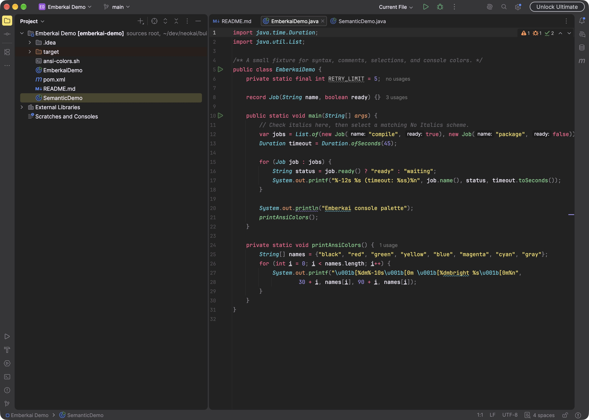
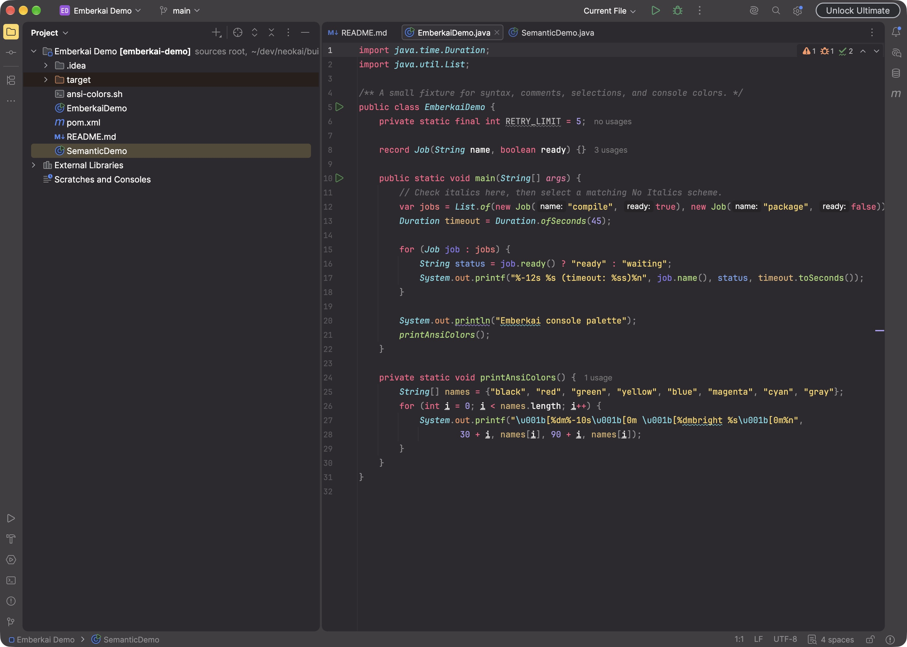
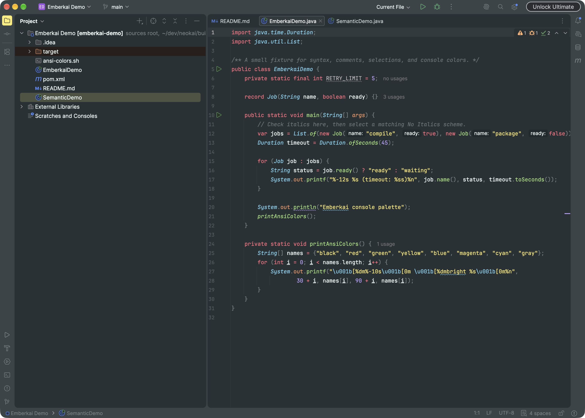
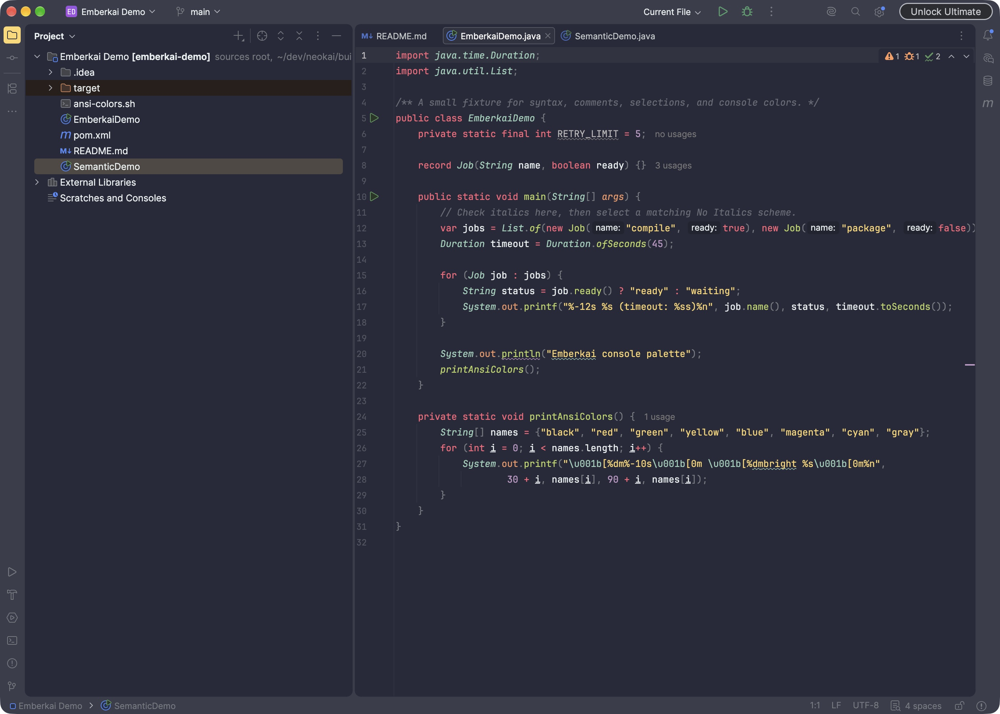
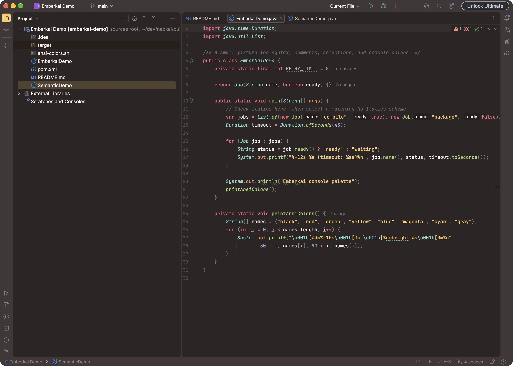
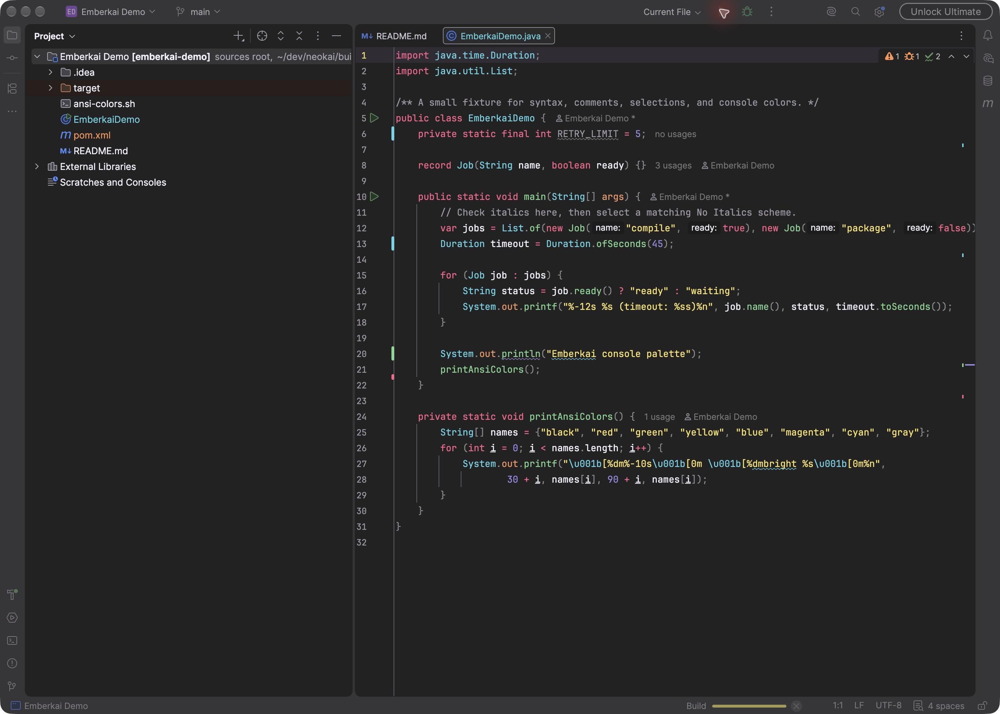
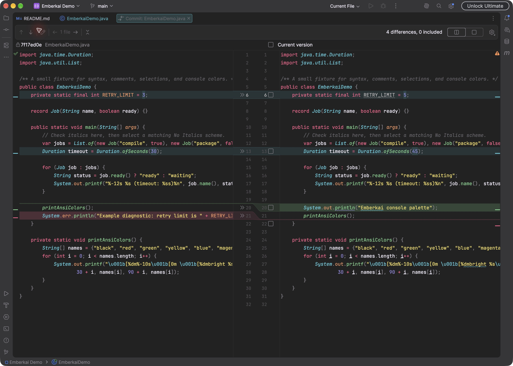
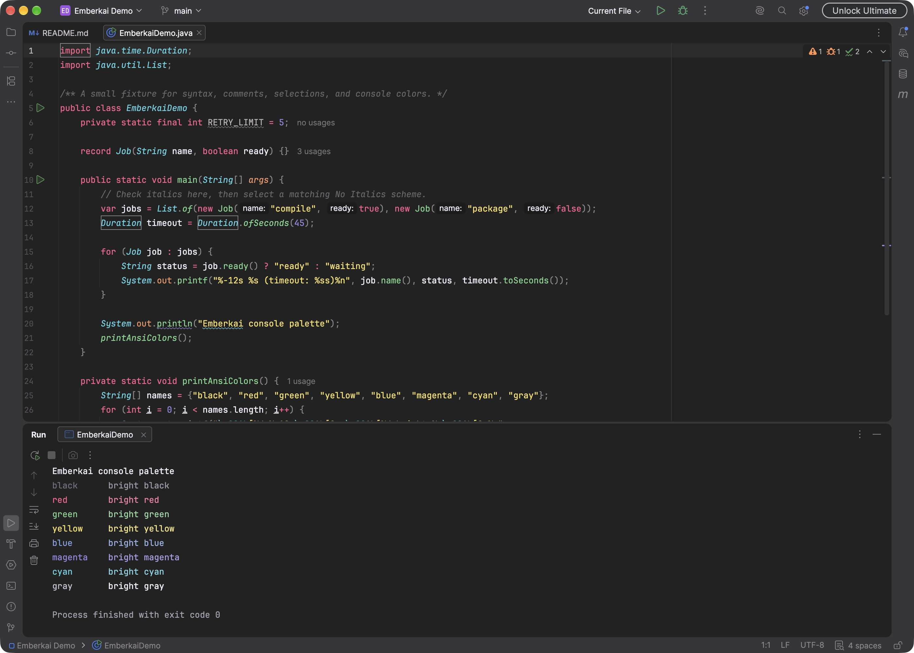

# Emberkai Theme


A dark theme collection for IntelliJ-based IDEs, using the Islands layout.

Includes five palettes: Default, Machine, Octagon, Ristretto, and Spectrum,
plus optional **No Italics** editor schemes.

Every palette includes a **Contrast** option with brighter comments and secondary
text, plus **Teal** and **Rose** Islands accents. Accent presets keep the palette's
syntax colors. All palettes include coordinated diff and console colors.

Requires **IntelliJ Platform 2025.3 or newer**.

## Preview

Direct IntelliJ IDEA captures, with no mouse pointer. See the
[full screenshot gallery](docs/screenshots/README.md) for palettes, accents, and features.

### Color palettes

All five palettes in the Islands layout. Click a preview to see it at full size.

| Spectrum | Default |
| --- | --- |
| [](docs/screenshots/spectrum-islands.png) | [](docs/screenshots/default-islands.png) |
| **Machine** | **Octagon** |
| [](docs/screenshots/machine-islands.png) | [](docs/screenshots/octagon-islands.png) |
| **Ristretto** | |
| [](docs/screenshots/ristretto-islands.png) | |

### Features

Spectrum Islands Contrast, compact mode, with the matching No Italics scheme:



Spectrum Islands Teal in the diff viewer:



| ANSI console colors | Optional semantic highlighting |
| --- | --- |
| [](docs/screenshots/spectrum-teal-console.png) | [](docs/screenshots/spectrum-semantic-highlighting.png) |

The gallery also compares [Teal and Rose accents](docs/screenshots/README.md#teal-and-rose-accents).

## Build and install

```sh
./gradlew buildPlugin
```

1. Open **Settings → Plugins → gear menu → Install Plugin from Disk…** and
   select the ZIP from `build/distributions/`.
2. Choose an Emberkai theme under **Settings → Appearance & Behavior → Appearance**.
3. For no italics, choose the matching scheme under **Settings → Editor → Color Scheme**.

Optional [semantic highlighting](docs/semantic-highlighting.md) gives individual
parameters and local variables colors from a range matched to your palette.

## Optional file icons

Install [Symbols Icons](https://github.com/joansgarcia/jetbrains-symbols) separately
to use its file and folder icons with Emberkai. The common Symbols colors follow
the selected Emberkai palette automatically. Contrast variants brighten neutral
icons; Teal and Rose keep their palette's icon colors. Icons keep their colors
when selected in the Project panel.

Emberkai uses JetBrains' global SVG color replacements. Other icons using the
same source colors can also change. The replacements are active whenever an
Emberkai theme is selected, even without Symbols installed. See
[icon color support](docs/icon-colors.md) for the mappings and limitations.

## Development

To preview in a development IDE, run `./gradlew runIde`.
Checks: `./gradlew check verifyPluginStructure verifyPlugin`. See [validation](docs/validation.md)
for the visual smoke test.

[Release instructions](docs/releasing.md) · [Changelog](CHANGELOG.md) ·
[Report an issue](https://github.com/khopland/emberkai-intellij/issues)

## Credits

[Neokai by tautastic](https://github.com/tautastic/neokai),
[Monokai Pro Theme by Subtheme](https://github.com/espositocode/monokai-pro),
and the original [Monokai color design](https://monokai.pro).

Licensed under [Apache 2.0](LICENSE), with inherited [MIT notices](NOTICE).
