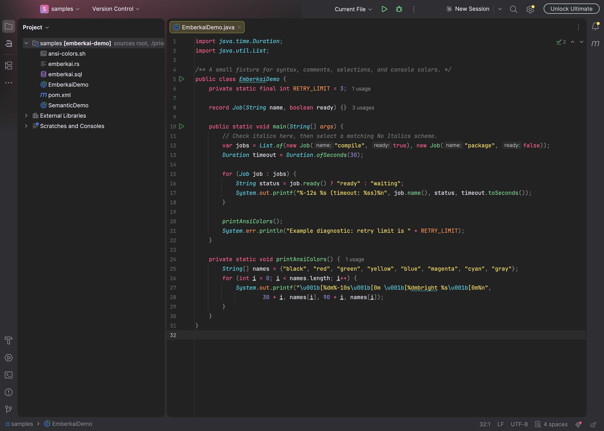

# Emberkai

Check Markdown colors: headers, **bold** and *italic* text, `code spans`, links,
lists, quotes, tables, and fenced code.

## Presets

1. **Emberkai Islands**: the [dark theme](https://github.com/khopland/emberkai-intellij)
2. *Emberkai Light*: warm paper backgrounds
   - with a ~~light~~ matching editor scheme

> [!NOTE]
> Choose a matching No Italics scheme under **Settings → Editor → Color Scheme**.

| Role    | Dark      | Light     |
| ------- | --------- | --------- |
| Keyword | `#fc618d` | `#e1346e` |
| String  | `#fce566` | `#c27800` |

```kotlin
val accent = Swatch("ember", Hex(0xfd9353))
```

---


