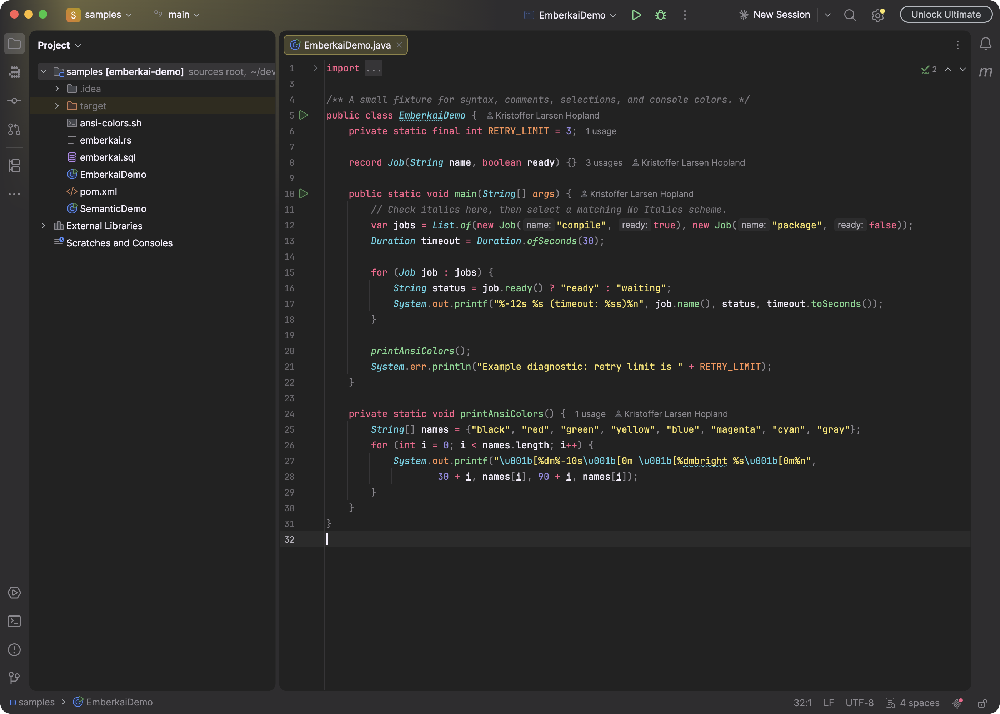
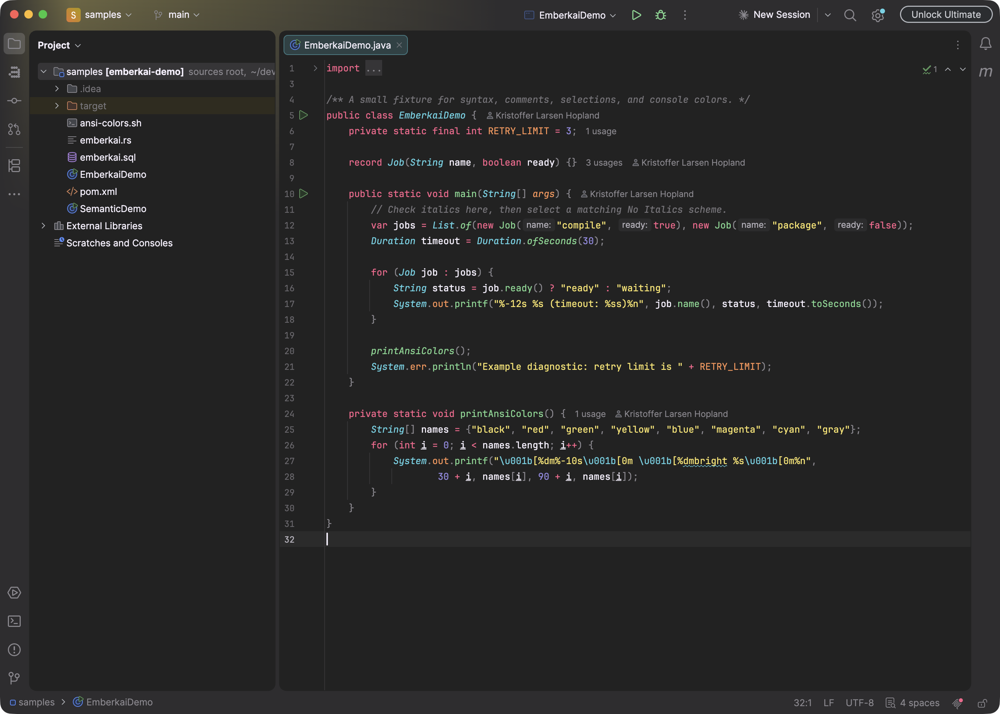
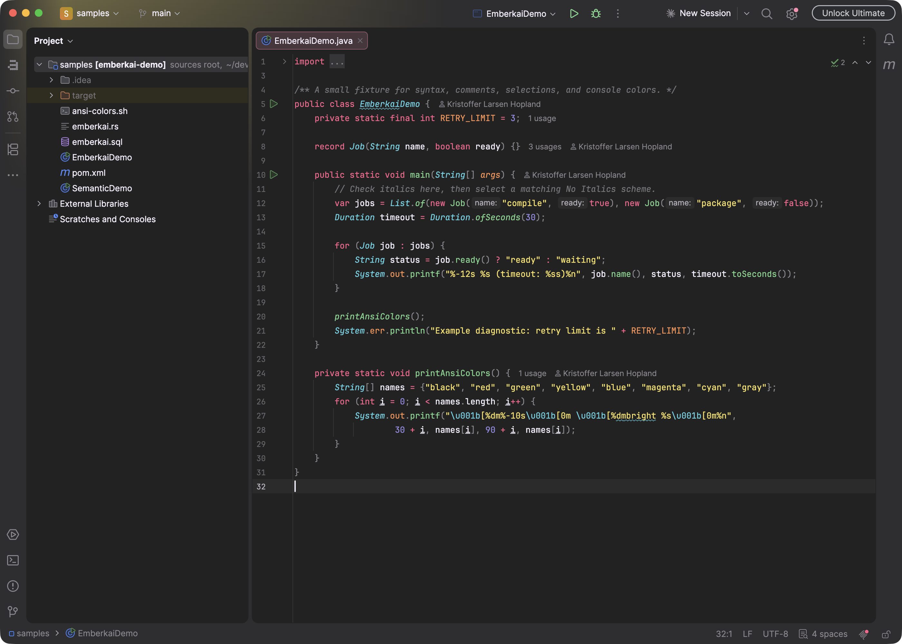
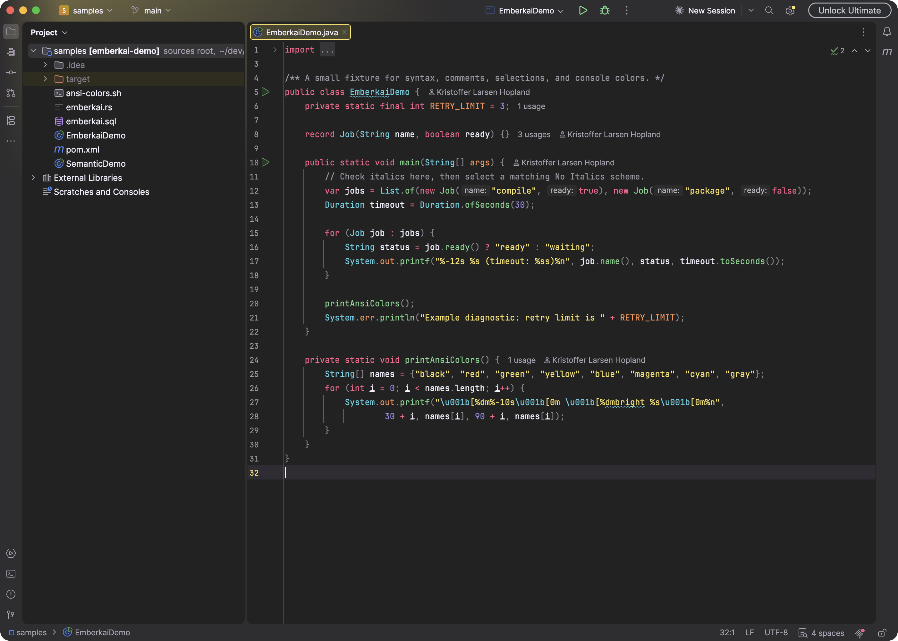
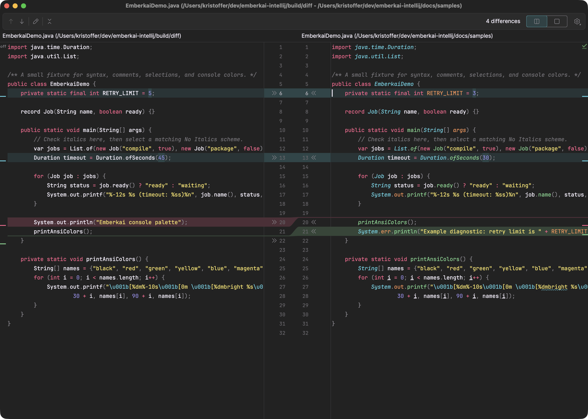
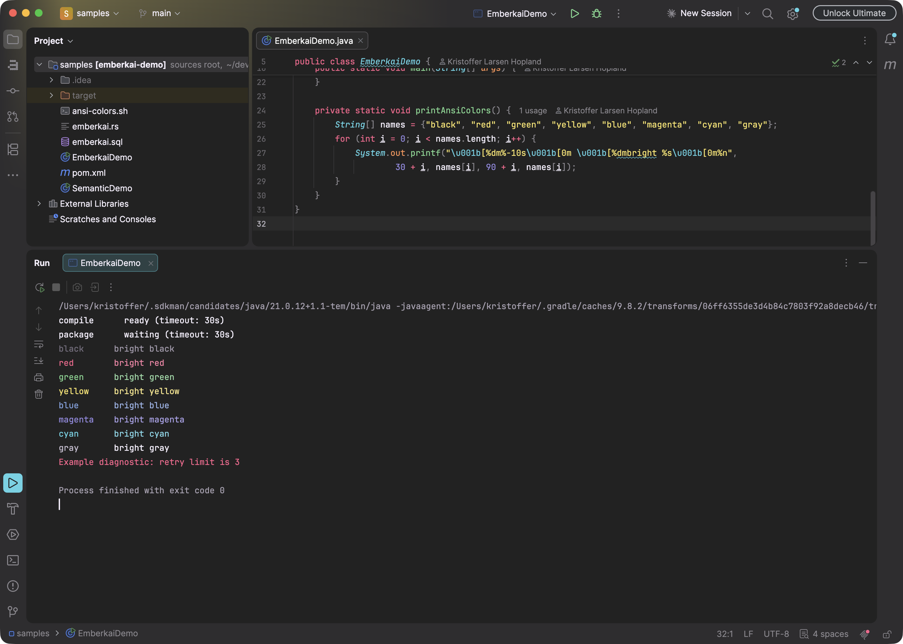
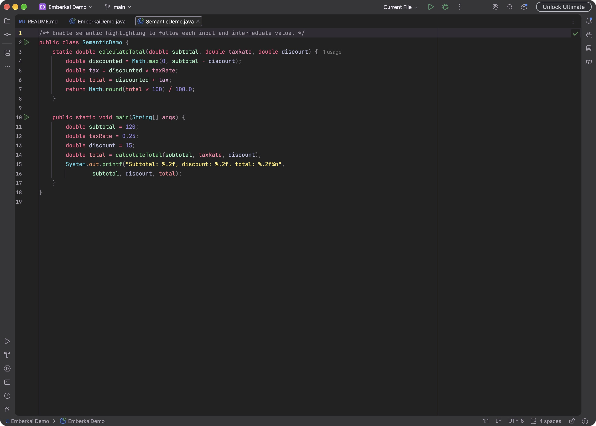

# Emberkai in IntelliJ IDEA

Direct captures from IntelliJ IDEA 2026.2.3 on macOS, taken on 25 October 2026
using the [sample project](../samples/pom.xml). Images are 2800 × 2000 pixels
and contain no mouse pointer. Click any preview to open the full-size image.

## Emberkai Islands

The Java fixture in the compact Islands layout.

## Teal and Rose accents

Accent presets change the selected controls and tabs while keeping the same
syntax colors.

| Teal | Rose |
| --- | --- |
|  |  |

## Contrast and No Italics

Emberkai Islands Contrast with brighter comments and secondary text, compact
spacing, and the matching **Emberkai Contrast - No Italics** scheme.

## Diff viewer

Emberkai Islands Teal, showing modified, inserted, and deleted lines between
the sample and a local copy.

## ANSI console colors

Emberkai Islands Teal in the Run console, showing all eight normal and eight
bright ANSI colors. The sample finishes with exit code 0.

## Semantic highlighting

Emberkai Islands Contrast with No Italics and optional semantic highlighting
enabled. Parameters and local variables receive distinct colors, repeated at
their references. See the [setup guide](../semantic-highlighting.md).

## Taking new screenshots

Use an isolated development IDE profile and the sample project. Keep the same
file, editor size, and spacing when comparing presets. Move the mouse pointer
out of the captured content before saving, dismiss tooltips and popups, and wait
for code analysis or sample execution to finish. Check the saved PNG itself for
the pointer or its highlight before adding it here.
