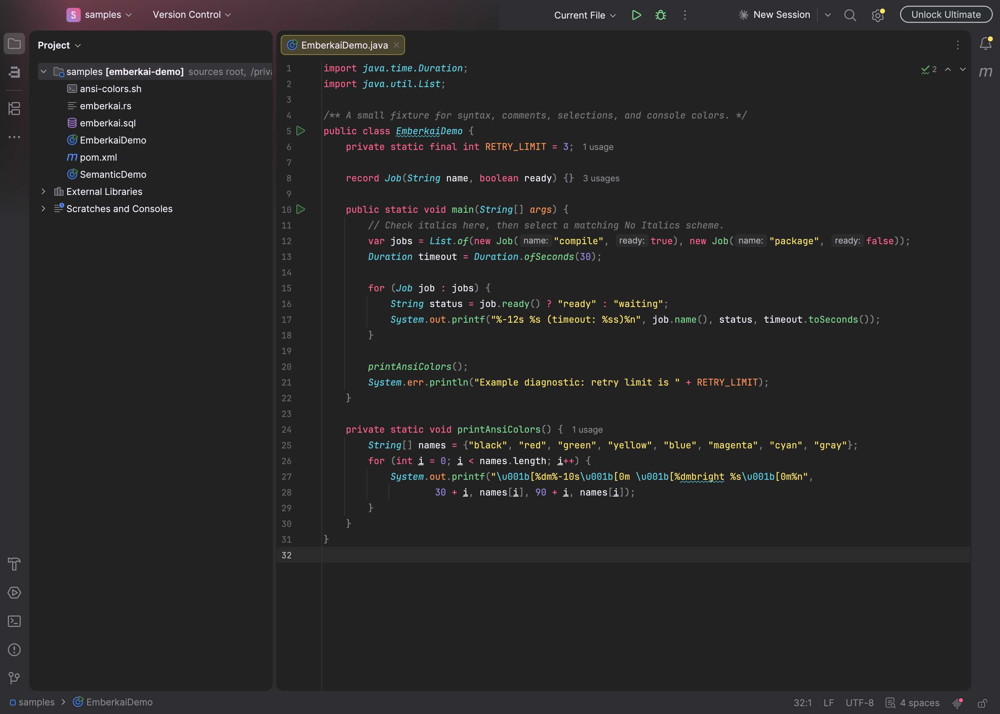
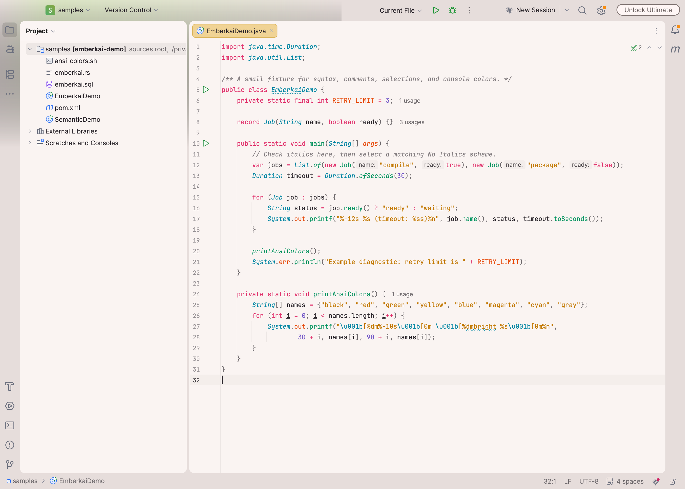
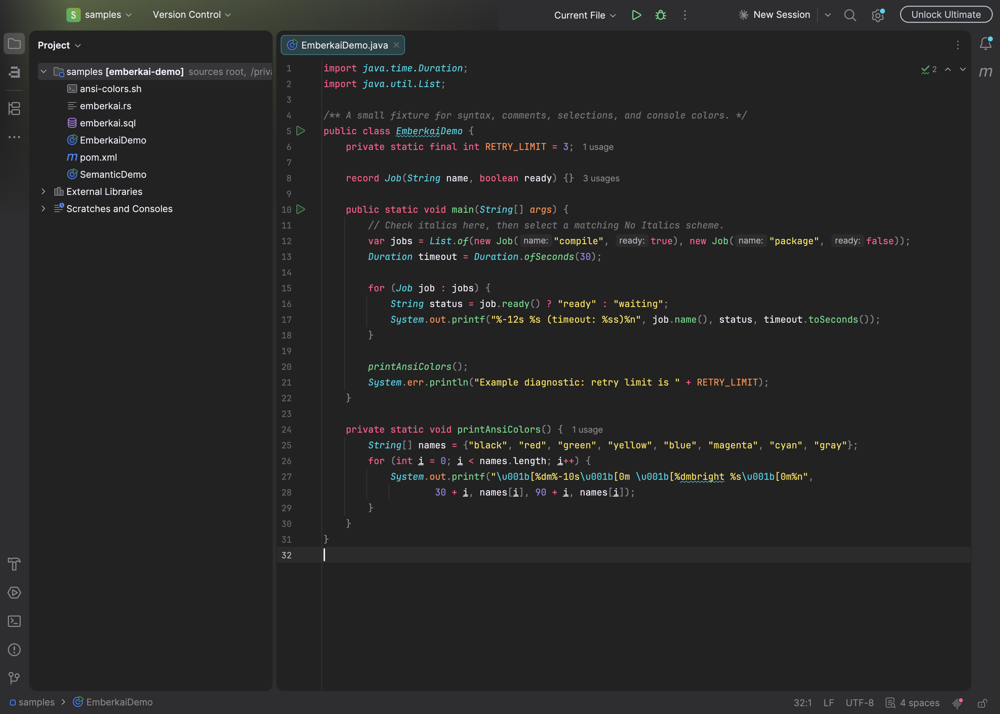
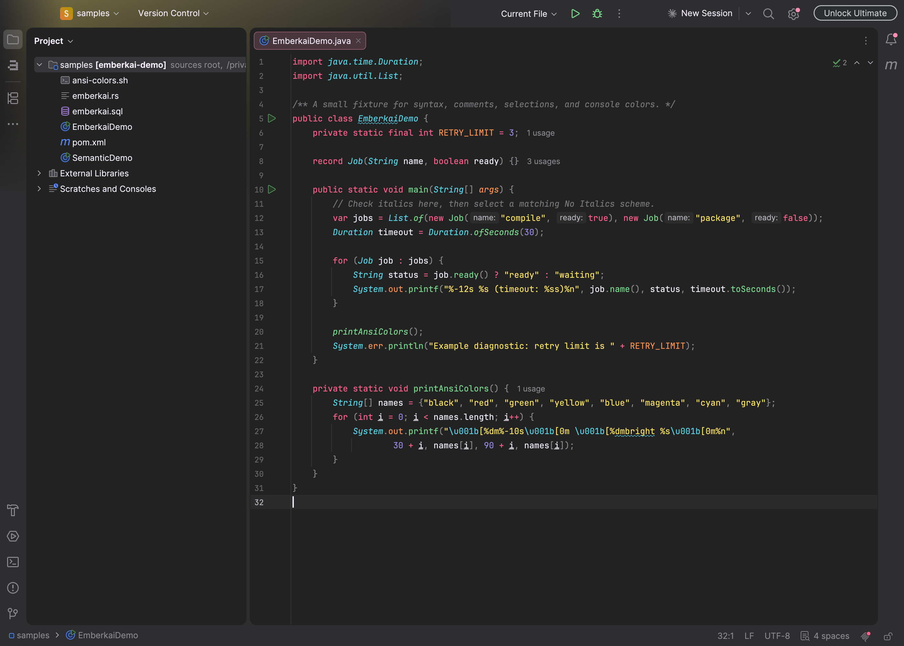
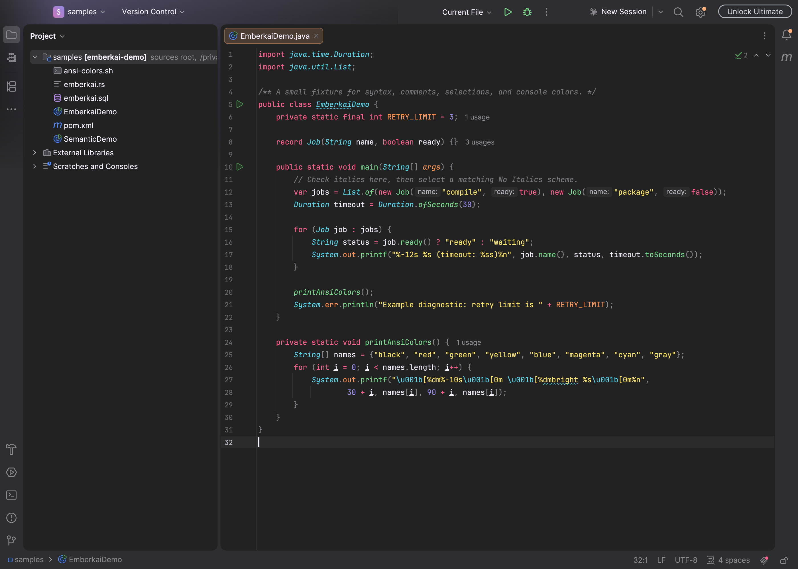
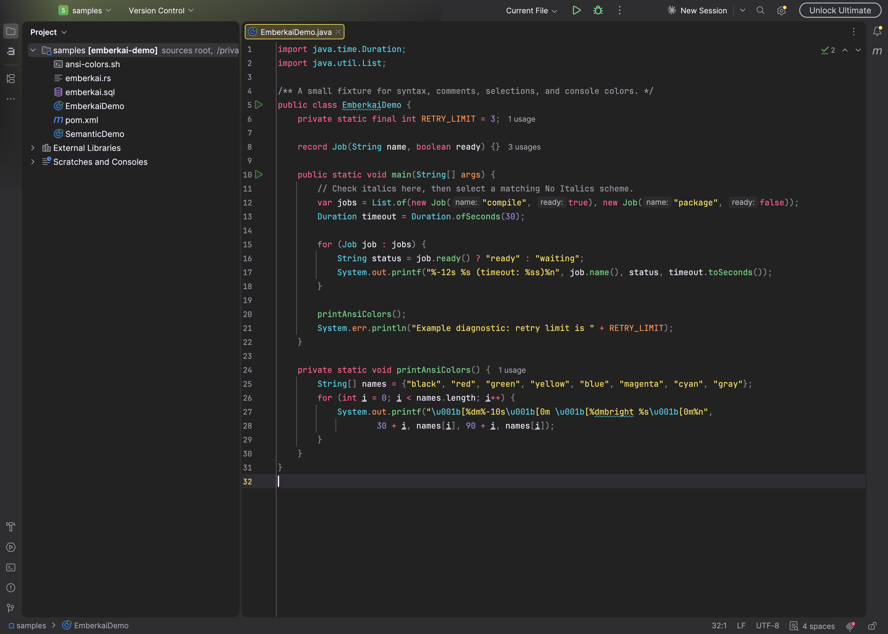
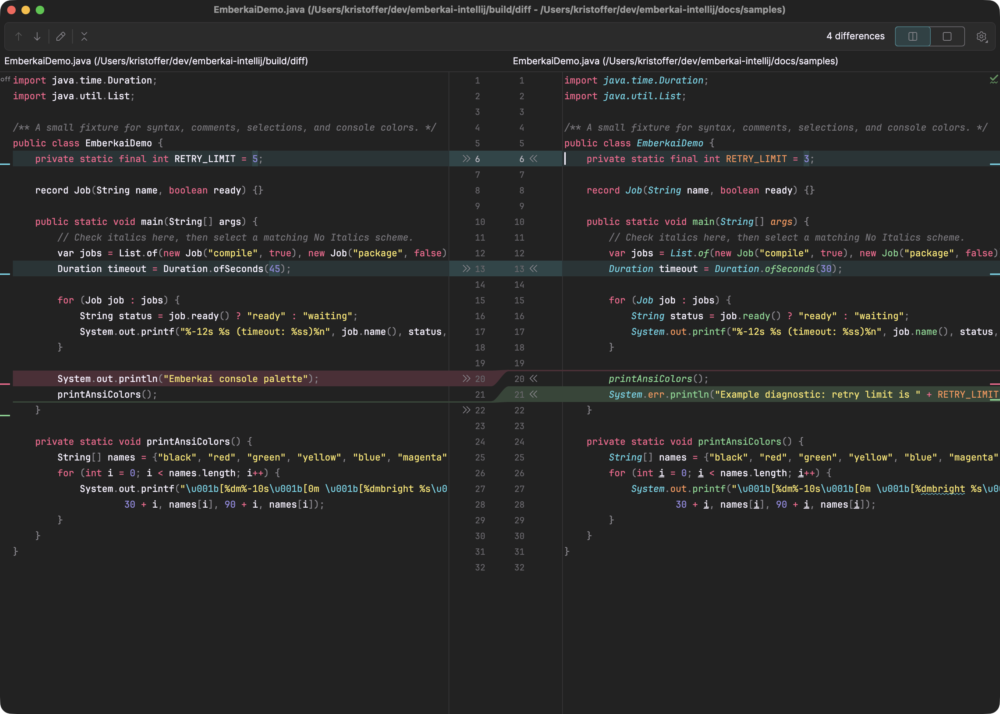
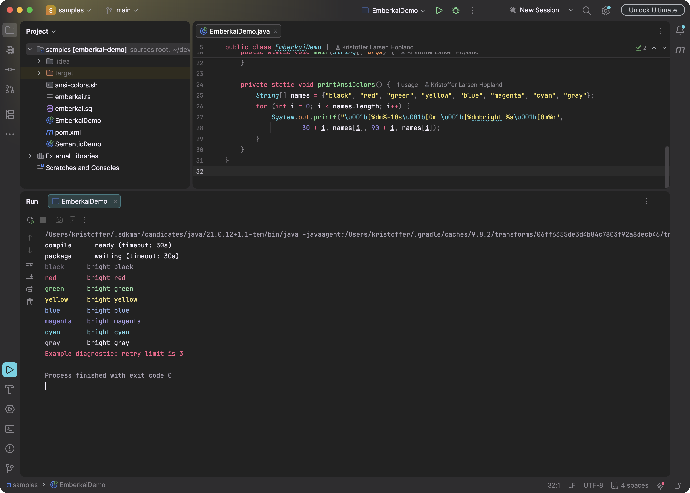
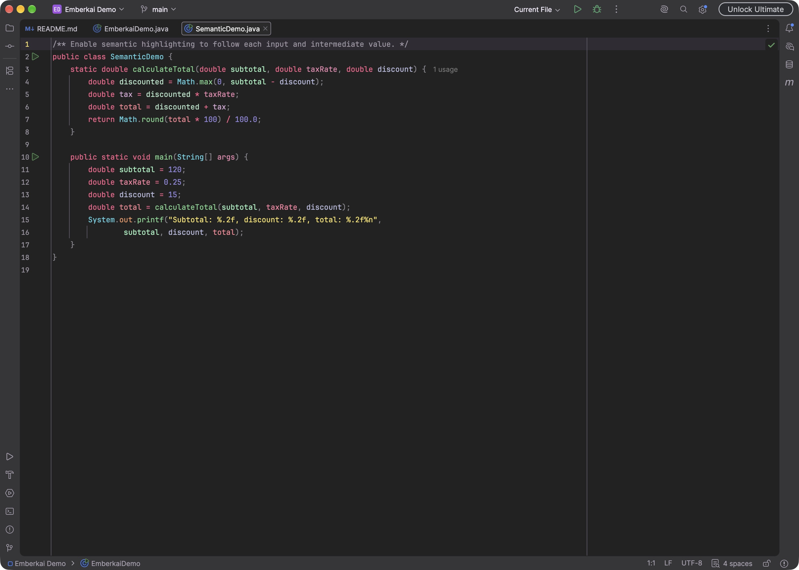

# Emberkai in IntelliJ IDEA

Direct captures from IntelliJ IDEA 2026.3 on macOS using the
[sample project](../samples/pom.xml). The editor captures are generated by
`./gradlew screenshots` (25 November 2026). The diff viewer and console captures
were taken by hand on 11 November 2026, and the semantic highlighting capture on
2026.2.3 on 25 October 2026. Images are 2800 × 2000 pixels and contain no mouse
pointer. Click any preview to open the full-size image.

## Emberkai Islands

The Java fixture in the Islands layout.

[](emberkai-islands.png)

## Emberkai Islands Light

Warm paper backgrounds, a bright orange accent, and the **Emberkai Light**
editor scheme, which uses darker versions of the dark palette's hues.

[](emberkai-light.png)

## Teal, Rose, and Ember accents

Accent presets change the selected controls and tabs while keeping the same
syntax colors.

| Teal | Rose | Ember |
| --- | --- | --- |
| [](emberkai-teal.png) | [](emberkai-rose.png) | [](emberkai-ember.png) |

## Contrast and No Italics

Emberkai Islands Contrast with brighter comments and secondary text, compact
spacing, and the matching **Emberkai Contrast - No Italics** scheme.



## Diff viewer

Emberkai Islands Teal, showing modified, inserted, and deleted lines between
the sample and a local copy.



## ANSI console colors

Emberkai Islands Teal in the Run console, showing all eight normal and eight
bright ANSI colors. The sample finishes with exit code 0.



## Semantic highlighting

Emberkai Islands Contrast with No Italics and optional semantic highlighting
enabled. Parameters and local variables receive distinct colors, repeated at
their references. See the [setup guide](../semantic-highlighting.md).



## Taking new screenshots

```sh
./gradlew screenshots                 # every editor capture
./gradlew screenshotEmberkaiLight     # one capture
./gradlew marketplaceScreenshots      # 16:10 Marketplace media in docs/marketplace
```

Each capture starts the development IDE with a fresh profile on a copy of the
sample project outside Git, so no branch name or author hints appear. A startup
script selects the theme, editor scheme, and spacing and sizes the window to
1400 × 1000 points. When code analysis has finished, the IDE paints its window
into `docs/screenshots/<name>.png`. Captures never include the mouse pointer,
tooltips, or other windows, and take about 30 seconds each. The list of
captures is in `build.gradle.kts`.

On a 2x display the images are 2800 × 2000 pixels. On a 1x display, such as Xvfb,
add `-PscreenshotScale=2`. The **Screenshots** workflow does this on Linux for
pull requests that change the themes, schemes, or samples, and uploads the
images as an artifact for review. Commit captures from macOS so the gallery
keeps the same font rendering.

The diff viewer, console, and semantic highlighting captures are still taken by
hand. Use an isolated development IDE profile and the sample project, keep the
same editor size and spacing, dismiss tooltips and popups, and wait for code
analysis or sample execution to finish. Check the saved PNG for the mouse
pointer before adding it here.
