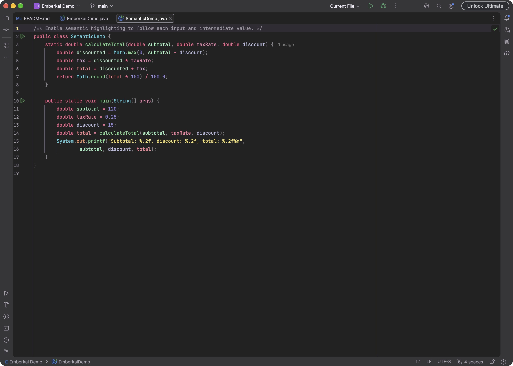

# Semantic highlighting

Every Emberkai editor scheme includes a palette-matched semantic color range.
IntelliJ can use it to give individual parameters and local variables different
colors, making their references easier to follow within a method.

To enable it, open **Settings → Editor → Color Scheme → Language Defaults →
Semantic highlighting** and select **Semantic highlighting**. To enable it only
for one supported language, open that language's Semantic highlighting page,
clear **Inherit values from**, and select **Semantic highlighting** there.

It is off by default. Turning it off restores the scheme's normal parameter and
variable colors. See [JetBrains' documentation](https://www.jetbrains.com/help/idea/configuring-colors-and-fonts.html#semantic-highlighting)
for language inheritance and customization.

The five color stops follow each palette's teal, violet, rose, orange, and green
tones. Contrast schemes use brighter ranges; matching No Italics schemes share
the same colors. Islands themes, including Teal and Rose accents, use the range
from their selected editor scheme.

IntelliJ generates intermediate shades and can adjust them to distinguish them
from diagnostics and other editor colors. The IDE assigns colors; a specific
variable name does not have a fixed color across every scope or project.

Open [SemanticDemo.java](samples/SemanticDemo.java) in the
[sample project](samples/pom.xml) to compare the enabled and disabled views.

Spectrum Islands Contrast with No Italics and semantic highlighting enabled:

